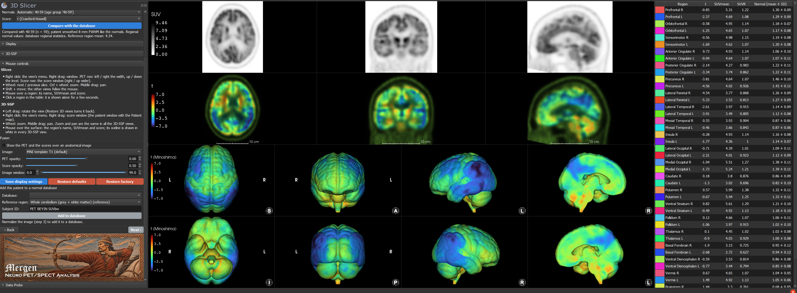
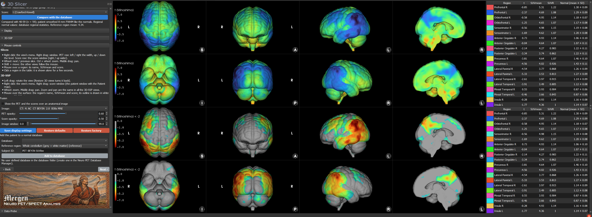
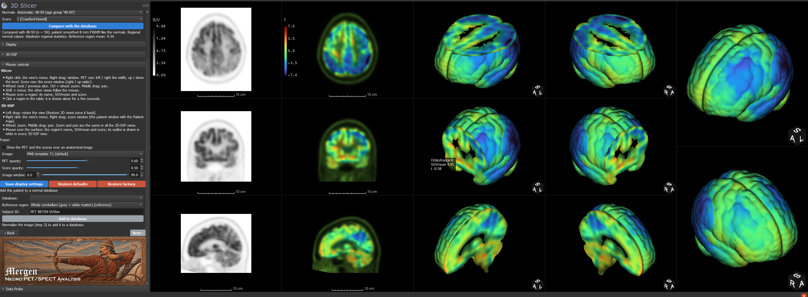

<p align="center">
  
</p>

# Mergen: Neuro PET/SPECT Analysis (3D Slicer)

Author: Burak Demir, MD FEBNM - Kocaeli City Hospital Department of Nuclear Medicine - 4burakfe@gmail.com

Brain PET and SPECT workflows for 3D Slicer: **Dynamic Neuro Receptor PET**, **Static Neuro PET/SPECT** and the
**Neuro PET Database Manager** (normal databases). Repository: SlicerNeuroPET; extension name: *NeuroPET*.

**Highlights**

- Step-by-step workflows with a toolbar of steps (done / ready / waiting), Back / Next and a **Panel** button that
  hides the module panel for more room.
- Spatial normalization to the **MNI ICBM 152 nonlinear symmetric 2009c** template (from the PET, from the patient's
  CT / MR, or to a PET template), with manual correction and Harden / Revert.
- **CerebrA** regions (left / right, bilateral or broad regions, with the pons), region growing and reference regions.
- **Normal databases** of PET and SPECT: user defined (subjects added one by one or as a BIDS batch, iterative
  template building) or predefined (mean / SD maps only), with age groups and regional / 3D-SSP statistics.
- **Review** of a static study against a normal database: voxel z / Crawford-Howell t maps, regional scores and
  **3D-SSP** (Minoshima) surface projections, in single or dual monitor layouts, including slices with **3D-SSP cut at
  the slice**.
- Dynamic receptor PET: motion correction, CT / MR registration, normalization, regions and kinetic modeling (SRTM)
  through the PET4D modules.

## Screenshots

**Static Neuro PET/SPECT, Review, *Single monitor*:** the normalized PET, the score slices, the eight 3D-SSP views and
the region table.



**Review, *3D-SSP + low scores and table*:** the 3D-SSP t map (top) and the scores below -2 only (bottom).



**Review, *Slices + cut 3D-SSP (3 x 4)*:** each row (axial, coronal, sagittal) shows the PET, the score slice and the
3D-SSP cut at that slice; the right column shows the whole 3D-SSP.



**Contents:** [Dynamic Neuro Receptor PET](#dynamic-neuro-receptor-pet-workflow) ·
[Neuro PET Database Manager](#neuro-pet-database-manager) ·
[Static Neuro PET/SPECT](#static-neuro-petspect-workflow) · [Installation](#installation) ·
[Developer notes](#developer-notes) · [License](#license)

Mergen is built on the **PET4D** extension ([SlicerPET4D](https://github.com/4burakfe/SlicerPET4D)):
its DICOM plugin loads the PET series, and its Review/Edit, Motion Correction, CT/MR Registration and Modeling modules
are the panels of the workflow steps. PET4D is a dependency of this extension (installed with it from the Extensions
Manager); PET4D itself works without Mergen.

> **Intended use.** Research software. It is not a certified medical device and must not be used for
> clinical diagnosis.

## Dynamic Neuro Receptor PET (workflow)

The **Dynamic Neuro Receptor PET** module (*Mergen - Neuro PET - Dynamic*, Nuclear Medicine) is a step-by-step workflow for **dynamic
receptor PET of the brain**. A **workflow toolbar** at the top of the main window (shown while the module is open)
has the steps with their state (done, ready, waiting); click a step to open it, or use Back / Next in the panel. Steps
can be skipped. Steps 2, 3 and 6 are the panels of the modules above, shown inside the workflow; the series a step makes
(e.g. a motion corrected series saved separately) is the series of the next step. Leaving motion correction, CT/MR
registration or normalization with a result that is not hardened asks whether to **Harden** it first (or continue
without, the result is kept, or stay).

1. **Data:** the patient's **dynamic PET** series and the **CT / MR**. The MR contrast is read from the DICOM tags
   (series description, protocol and sequence name, else TR / TE / TI): T1 (MPRAGE, SPGR, BRAVO, TFE, ...), T2
   (also FLAIR), PD, or CT; it can be set by hand.
2. **Motion correction** (Dynamic PET Motion Correction).
3. **CT/MR registration** (Dynamic PET to CT/MR Registration).
4. **Normalization** to the **MNI ICBM 152 nonlinear symmetric 2009c** template (the method, template and
   registration settings under **Normalization settings**, folded at start; a PET template, the synthetic PET or a
   database's mean PET, is shown in inverted grey here and in the Regions step). By default the **iterative
   multi-resolution** engine runs **one affine stage** down to a **1 mm** final level with the **Thorough** sampling
   (about 4 GB of memory and fast; the deformable passes, B-spline grid 30 mm, can be turned on). **BRAINSFit** can be
   picked instead: **rigid + scale + skew** (BRAINSFit `ScaleSkewVersor3D`; *Affine* can be picked) **then B-spline**.
   BRAINSFit registers copies of the template and of the CT/MR (or PET) **smoothed and resampled to 2 mm**
   (*Register at*, as FSL's 2 mm MNI template; 0 for the images as they are); the transform applies to the original
   images. A 0.5 mm MR against the 1 mm template otherwise takes tens of GB. The sizes BRAINSFit gets are written to
   the log. The method is **the CT/MR when the study has one**, else the PET (until it is picked by hand):
   - **Register the PET to the template:** the summed image (else the frame of the highest activity) to the
     **T1** template, centres of mass as the start (skull-stripped with the template's brain mask, on by default; off
     for the CT/MR method).
   - **Normalize the CT/MR, apply the same transform to the PET:** the CT/MR is registered to the template of its
     contrast (T1, T2 or PD; CT to the T1) and the same transform moves the PET, which must already lie on the CT/MR
     (step 3, or PET/MR). The CT/MR is normalized too.

   The result is shown in the registration layout (PET, fusion, template, checkerboard) with manual correction;
   with the CT/MR method the **normalized CT/MR** is on the right, **over the template** (Inferno) in the fusion
   column, and the **PET over the template** in the PET column. BRAINSFit's B-spline to the template uses a
   **12-subdivision grid** (*B-spline grid*; control points about 16 mm apart) and a stopping factor of 1e9 instead of
   BRAINSFit's 2e13; it samples 0.005 of the voxels (*Sampling*; BRAINSFit's default 0.002). Every BRAINSFit option of the normalization is under **Advanced (BRAINSFit)**: *Register at*, *B-spline grid* (one number or i,j,k), *Sampling*, *Iterations*, *Histogram bins*, *Convergence factor*, *Gradient tolerance*, *Max evaluations*, *Max corrections*, *Max B-spline shift* and *Threads* (fewer threads use less memory), with *Reset to defaults*;
   **Harden** resamples every frame and the summed image onto the template's field of view (PET voxel size by
   default) into a new series *"&lt;series&gt; MNI"* (or overwrites it). **Revert** undoes it.
5. **Regions:** a **segmentation** of the space (from the atlas library, below) and its **grouping**:
   **Regions R/L** (every structure, left and right separate, *Putamen R* / *Putamen L*), **Broad regions R/L**
   (structures merged by `groups.csv`) or **Broad (Compatible)** (by `groups_compatible.csv`); a grouping is offered
   only when the segmentation has its table. The **reference region** is any region of the picked segmentation and
   grouping with the sides merged (default: **Cerebellum Gray Matter**, added as *"Cerebellum Gray Matter
   (reference)"*). Segment names come from the segment names of `labels.seg.nrrd` (*Caudate R*; *Segment_<value>*
   is read too); the label numbers and the list of regions come from `labels.csv`. The label maps of the groupings are
   made on first use and again whenever the segmentation or a table changes.
   The extension comes with two segmentations:
   **CerebrA** (CerebrA with the pons added as *Pons R* / *Pons L*, the rest of the brainstem as *Brainstem (except
   pons)*, no optic chiasm) and **CerebrA PET** (CerebrA edited for PET: caudate edited, left mirrored, the regions
   already grown into the white matter: cortex 3 mm; cingulate, insula, basal ganglia, thalamus, amygdala,
   hippocampus 2 mm; brainstem, pons, cerebellum, diencephalon not grown; use it with 0 mm growth).
   **Broad regions:** prefrontal, orbitofrontal, sensorimotor, anterior / posterior cingulate, precuneus, lateral
   parietal, lateral / mesial temporal, insula, lateral / medial occipital, caudate, putamen, ventral striatum,
   pallidum, thalamus, cerebellum, vermis, brainstem (except pons), pons; the ventricles and the optic chiasm are left
   out (`groups.csv`, `Group;Structures;Notes`).
   **Broad (Compatible):** broad regions like those of GE CortexID, for comparison studies: *Prefrontal Lateral*,
   *Prefrontal Medial*, *Sensorimotor*, *Anterior / Posterior Cingulate*, *Precuneus*, *Parietal Superior /
   Inferior*, *Occipital Lateral*, *Primary Visual*, *Temporal Lateral / Mesial* (each *R / L*), *Cerebellum Whole*
   and *Pons* (one region each). Table: `groups_compatible.csv` (`Group;Structures;Sides;Notes`, *Sides* = `merged`
   for one region over both sides). CerebrA (Desikan-Killiany based) cannot split
   every CortexID region: *Superior Frontal* (dorsolateral and dorsomedial) is counted as medial prefrontal,
   *Primary Visual* is pericalcarine + cuneus + lingual, *Posterior Cingulate* is the CerebrA label alone (*Isthmus Cingulate* a region of its own), the fusiform is
   lateral temporal; insula, basal ganglia (caudate, putamen, pallidum, accumbens) and thalamus are added as R / L regions (not CortexID regions). A database made with this
   atlas needs *Compute mean/SD*.
   **Grow regions** (mm, off by default): the regions grow into the unlabelled voxels around them, each voxel to
   the nearest region (so they never overlap and the order does not matter), only inside the MNI brain mask and,
   by **Grow into**, where the white matter probability is below 0.5 (CSF and the cortex edge, the default),
   into the white matter too, or into the white matter only (no outward growth into CSF; needs the white matter
   map); the ventricles and the pons do not grow. **Erode reference**
   (mm, off by default): the reference region, taken from the atlas before growing, is eroded against spill-over.
   **Output segmentation:** the segmentation the regions are written into (its segments replaced), by default the
   one loaded before, so loading again does not pile up segmentations; *Create new segmentation* makes a new one.
6. **Modeling** (Dynamic PET Modeling), ready with the normalized series, the regions, **SRTM**, the reference region
   and the putamen as the target.

**Atlas library.** Spaces and segmentations are read from two folders: the user's atlas folder
`~/NeuroPET/Atlas` (made on first use; **Open atlas folder** in the Normalization step and the Database Manager
opens it) and the extension's `Resources/Atlas`. Nothing has to be picked; the user's files come first.

```
<atlas folder>/
    Space/<space id>/
        space.json            name, voxelSizeMm, dimensions, description, url, sources
        T1.nrrd  T2.nrrd  PD.nrrd  GM.nrrd  WM.nrrd  CSF.nrrd  mask.nrrd  CT.nrrd  CT_GM.nrrd   (any of them)
    Segmentation/<segmentation id>/
        segmentation.json     name, space (a space id), voxelSizeMm, description, recommendedGrowMm, sources
        labels.seg.nrrd       segments named after the structures (or labels.nrrd, a label map)
        labels.csv            label table (CerebrA format: Label Name, RH Label, LH Label; ',' or ';')
        groups.csv            optional: Broad regions R/L
        groups_compatible.csv optional: Broad (Compatible)
```

File names are fixed. **NRRD is the standard** for the volumes (the files made are .nrrd); .nii.gz / .nii are read
too. A space in both folders is merged volume by volume (e.g. a T2 of your own added to the extension's MNI space);
a segmentation in the user folder replaces the extension's one of the same id. In the Normalization step the
**space** is picked (MNI152NLin2009cSym by default) and **Volume** lists the space's volumes that fit the method (PET: T1,
T2, PD, GM, synthetic PET; CT/MR: the MR's contrast, CT: CT). The extension has the space
*MNI152NLin2009cSym* (*ICBM 2009c Nonlinear Symmetric*: T1, GM, WM, brain mask) and the segmentations *CerebrA* and
*CerebrA_PET*. Files made from them (label maps of the groupings, the synthetic PET template) are written to
`~/.PET4D/NeuroAtlas` (or `$PET4D_NEURO_ATLAS_CACHE`), not into the atlas folders. The full sets are at the
[MNI](https://nist.mni.mcgill.ca/icbm-152-nonlinear-atlases-2009/) and [CerebrA](https://nist.mni.mcgill.ca/cerebra/)
pages. The licenses of the files are in
[Resources/Atlas/LICENSE.txt](NeuroPET/Resources/Atlas/LICENSE.txt). Please cite Fonov et al., NeuroImage 2011;54:313-327 and NeuroImage 2009;47:S102 (ICBM
2009c), and Manera et al., Scientific Data 2020;7:237 (CerebrA).

Wherever a template, a region atlas or a normal database is picked (Normalization and Regions steps, the Database
Manager), a read-only box shows what it is, the references to cite and its license; for a normal database it
shows the database's own description (Edit settings: Notes) first, so a shared database carries the credits of
its data with it.

## Neuro PET Database Manager

The **Neuro PET Database Manager** module (*Mergen - Neuro PET - Database Manager*, Nuclear Medicine) keeps normal databases of brain PET and
SPECT in the MNI ICBM 152 2009c space (1 mm). Pick a database folder (until one is picked: `~/NeuroPET/Databases`,
made on first use, in the home folder so that the large maps stay out of a synced Documents folder); every database is
a folder in it, named after the database:

```
<database folder>/<database name>/
    database.json          header: mode, kind, nuclide, tracer, acquisition, space, region atlas, reference region,
                           smoothing, map type, age groups, notes, version, mean / SD maps with subjects per group
    reference_mask.nii.gz  the reference region mask
    subjects.csv           user defined only: one row per subject
    subjects/              user defined only: SUV and SUVR maps of each subject
    stats/                 master_mean / master_sd (all subjects) and age_<group>_mean / _sd
```

- **Static** tab (the Dynamic tab comes next): the databases in a table (type, nuclide, tracer, subjects,
  reference region, age groups, state of the mean / SD maps, version) with the details of the selected one.
- **Modality, nuclide, tracer**: PET (SUV / SUVR maps) or SPECT (counts / ratio maps, Tc-99m, I-123, Tl-201).
  Picking a nuclide lists only its tracers; the first entry is the nuclide itself (tracer not given), and any
  other nuclide or tracer can be typed.
- **Create new database...**: an empty *user defined* database in a **space** of the atlas library (fixed once
  made). Region atlas: a **segmentation** and its **grouping**. Reference region: **Global** (the space's brain
  mask), any **region of the segmentation** (sides merged; default *Cerebellum Gray Matter*) or a **custom** mask
  file; the mask is copied into the database, optionally eroded (mm). Optional age groups (the master mean / SD of
  all subjects is always made) and smoothing (FWHM). Subjects will be added from the Neuro workflows.
- **Add predefined database...**: a *predefined* database has no subject images, only mean and SD maps: either a
  package (.zip) or the maps picked one by one (master and each age group, with the number of subjects and whether
  they hold SUVR / SUV, or ratio / counts for SPECT).
- **Compute mean / SD** (user defined databases): the mean and SD (n - 1) maps from the subjects' maps (SUVR, or
  SUV for an SUV database), each smoothed with the database's **smoothing** FWHM (Gaussian; 8 mm is usual for FDG),
  added one at a time so 100+ subjects fit in memory: the master map of all subjects and, when age stratified, each
  age group with at least two subjects (`stats/master_mean.nii.gz`, `stats/age_<group>_sd.nii.gz`, ...). The
  subjects are stored unsmoothed, so a new FWHM only needs this step again; the patient is smoothed the same way in
  the review. The database version goes up at every computation. With the segmentation of the region atlas in the atlas library, the
  same pass makes the **regional statistics** (`stats/regions.json`): the regions drawn with the database's region
  settings (atlas, growth, reference mask; the optic chiasm left out), each subject's regional mean (unsmoothed
  maps) and their mean, SD and n per group (master and age groups); and the **3D-SSP projections**
  (`stats/ssp.npz`): the brain surface (union of those regions) and, per group, the vertex mean / SD of every
  subject's smoothed map projected on it (Minoshima: the maximum along the inward normal, 0-20 mm, the ray stopped where it leaves the regions). Both are
  exported with the database, so a predefined database carries them too.
- **Build template (iterative)...** (step 3; a study specific template from the stored native images): pass 0
  registers every subject to the database's **normalization target** (the PET to MR template method's template,
  e.g. the synthetic PET), the mean of those is template 0; each next pass registers the natives to the previous
  template starting from the last matrix, removes the group's mean drift (so the template stays anchored to the
  MNI space) and resamples each subject once from its native image. It stops when the subjects move less than the
  stop value (RMS of the brain box corners, 0.5 mm) or after the maximum number of passes (5). Templates are
  `templates/pass_<k>.nii.gz`, the log `qc/template_iterations.csv`. The last template becomes `template.nii.gz`,
  the database's normalization becomes PET to PET and the subjects' maps are replaced; then compute the mean / SD.
- **Normalize again...** (step 2): every subject normalized again from its stored native image with the database's
  current settings (e.g. after a new template), replacing its maps.
- **Edit settings...**: the settings of the selected database in the creation form. A new reference region (or
  erosion) makes the reference mask again and, for a user defined database, the subjects' SUVR maps from their SUV
  maps; reference, smoothing or age group changes put the mean / SD maps out of date; a new name renames the folder.
  A predefined database keeps the settings of its maps (reference, smoothing, age groups). Changing the normalization
  warns that the subjects already in were normalized with the earlier settings.
- **Add subjects...** (step 1, user defined databases): many normal subjects at once, from a BIDS folder
  (`sub-<id>[_ses-<session>]_pet.nii[.gz]` with the `.json` sidecars and `participants.tsv` for age and sex; pick the
  session, e.g. `SUV`) or from image files with a subject table (CSV / TSV with the columns id, age, sex; the file
  name starts with the ID). A single patient is added from the Static Neuro workflow (Review: **Add this patient to
  the DB**). Each **native image** (as loaded, before the normalization, with its tags) is stored in the database,
  normalized to the MNI space with the database's normalization settings (module defaults when the database has
  none, then stored with the first subject), without a manual check, resampled onto the database grid and added
  (SUV and SUVR maps, the database's reference mask). Subject IDs already in the database are skipped unless
  replacing is ticked; a failing subject is logged and the batch goes on. The log is `qc/batch_<time>.csv`, and a
  **QC picture** of each subject (the normalized PET over the MNI T1: axial, coronal, sagittal) is
  `qc/<id>_qc.png`. Check them and remove the badly normalized subjects (**Remove subjects...**: the selected
  subjects' folders are deleted) before the mean / SD maps.
- **CT / MR of the subjects** (optional; a database may hold subjects with and without one). **CT/MR** in Add
  subjects (default *None*): from a BIDS folder the same session's `anat/` (or `ct/`) file of the picked kind
  (`_ct`, `_T1w`, `_T2w` / `_FLAIR`, `_PDw`; *Any*: CT, then T1w, T2w, PD), from image files the subject table's
  column `anatomy` (or `ct`, `mr`; relative to the table). The PET is registered to its CT / MR (rigid; *already
  aligned* for a PET/CT or PET/MR) and moved onto it, both are stored as natives (`<id>_anat_native.nii.gz` + `.json`:
  contrast, source, how the PET was put on it) and normalized with the same transform: the CT / MR is saved on the
  database grid as `<id>_<contrast>.nii.gz` (a CT's voxels outside its field of view as air). With the **CT/MR
  method** the CT / MR is registered to the template of its contrast (the database's template when it fits, a CT to
  the CT template), the PET follows; subjects without one are asked about before the batch: their PET normalized to
  the database's target (noted in the log) or skipped. The workflow's **Add to database** adds the patient's CT /
  MR normalized at Harden too (*Add the CT/MR too*). **Compute mean / SD** writes the mean CT / MR of each contrast
  (at least two subjects; unsmoothed, an MR scaled to its brain median first) as `stats/anatomy_<contrast>_mean`,
  **Build template** a CT / MR template with the PET's (`templates/pass_<k>_<contrast>`, the last one
  `template_<contrast>`): a CT atlas in the database's space. They go into the predefined package.
- **From DB volumes**: the normalization's **Volume** list (workflow and Edit settings) offers the picked database's
  own volumes after the space's, by method: *PET to PET* its PET template, *PET to MR template* its MR means, *CT/MR*
  its mean of the patient's contrast ("From DB: &lt;name&gt; - CT mean"; stored as `db:CT`, so a renamed or shared
  database keeps it). When the database's space is not in the atlas folders, the space list shows *From DB
  (&lt;name&gt;)* with only its own volumes.
- **Storage** (format 2): one folder per subject, `subjects/<id>/` with `<id>_native.nii.gz` and `<id>_native.json`
  (the image as added and its tags), the CT / MR files when it has one (above), `transform.json` (native to MNI matrix of each template pass and the current
  one), `<id>_SUV.nii.gz` and `<id>_SUVR.nii.gz` (MNI ICBM 152 2009c, 1 mm, the reference mask's grid, linear
  interpolation, unsmoothed: the database's FWHM is applied to the mean / SD and to the patient). The **Pipeline**
  rows of the details show the grid, the native images present, the normalization target, the template (how it was
  built) and whether the mean / SD are up to date. A database of the older layout is moved to this one when it is
  selected.
- **Export as predefined...**: a user defined database as a .zip without its subject images (the number of
  subjects and an age summary are kept). Before writing, the export checks that the package holds all the Review
  needs, since a predefined database cannot fall back on its subjects: up-to-date mean / SD maps (and reference
  mask) on one grid, regional statistics of the current region settings for every age group and matching the stored
  regions, and 3D-SSP projections of the current settings (with medial surfaces when the regions have sides). The
  written .zip is read back to confirm every file its header names is in it.
- **Download predefined databases...**: the predefined normal databases published with the extension on the GitHub
  Releases of SlicerNeuroPET. Only releases whose tag starts with `static-` are listed (e.g.
  `static-fdg-normal-databases-v1`; `dynamic-` is kept for the dynamic databases later). Pick a release: its
  description and its packages are shown, with their size and status (*Not installed*, *Installed*,
  *Update available*). The checked ones are downloaded (size and SHA-256 checked) and installed into the
  database folder. A downloaded database keeps where it came from (`source` in database.json), so a package uploaded
  again to the release (e.g. with a new description or citation) shows as an update and replaces the old folder;
  a user defined database of the same name is never replaced. Without internet access, download the .zip files from
  the release page and use *Add predefined database*.
- **Delete database** removes the folder from disk after a warning.
- Every database also stores how its regions are drawn: the **region atlas** (CerebrA left / right, bilateral, or
  the broad regions), **grow regions** (mm; into CSF / cortex edge, white matter too, or white matter only) and the reference erosion. The Neuro
  workflows use the same settings when a patient is compared with the database.
- **Spatial normalization (to MNI)**: how the subjects were normalized (method, template, engine, linear and
  deformable stages, brain mask), each item optional ("Not specified"). The Static Neuro workflow takes them as its
  defaults when the database is picked and warns, without blocking, when a patient is normalized otherwise. A
  database without them takes those of its first added subject.

## Static Neuro PET/SPECT (workflow)

The **Static Neuro PET/SPECT** module (*Mergen - Neuro PET - Static*, Nuclear Medicine) is the workflow for a static brain PET or SPECT. Its
steps, on the toolbar like the Dynamic Neuro Receptor PET (each with a small pictogram next to its state; from step 2
on the patient's name and ID right of the module's name). **Back / Next** are right under the last element of the
step; a step opens at its top. Without a CT / MR, Next goes from the data straight to the normalization.

1. **Data**: the static PET (loaded by the PET4D DICOM plugin, SUV expected; Bq/ml gives a warning, ratio values are
   not affected) or SPECT (from the DICOM SPECT reconstruction module: counts, Bq/ml or SUV), and optionally the
   patient's CT / MR. Modality, units, nuclide and tracer are read from the tags of the loaders. **Import from
   file...** loads an image file; BIDS names such as `sub-00000016_ses-SUV_pet.nii.gz` are read with their `.json`
   sidecar (tracer, nuclide, units, timing) and the `participants.tsv` of the dataset (age, sex); a session or
   acquisition named `SUV...` means SUV units. **Patient**: the **name and patient ID** (from the DICOM tags or
   the subject hierarchy; the BIDS subject of an imported file as the ID), **age and sex** (from the tags); all can be
   typed. **Other sequences**: more volumes of the patient lying on the CT / MR (FLAIR, T2, ...), normalized with the
   same transform in step 3 for the fusion of the review.
2. **CT/MR registration** (optional): the image registered to the patient's own CT / MR, **iterative rigid only**
   (no scaling, no deformable passes; final resolution and quality can be set), checked in the registration layout,
   corrected by hand, then hardened (saved separately or overwritten; Revert).
3. **Normalization**: first the **normal database** the patient is compared with, from the database folder of the
   Database Manager. Databases of the image's modality, nuclide and tracer are listed first and the best one is
   picked; the others are marked with `!` and warn when picked. The database's normalization settings become the
   defaults of the page; other settings are allowed but warned about. Then the normalization to the MNI ICBM 152
   2009c space, three ways: the PET/SPECT to an MR template (T1, grey matter probability, or the **synthetic PET**:
   GM + 0.3 x WM smoothed 6 mm FWHM, made on first use next to the GM map), the **CT / MR** to the MR template with the
   same transform applied to the image (a **CT** as its brain only: skull stripped, 0 - 80 HU, to the skull-stripped
   template from the centres of mass, since the MR shows no skull; by default a CT study normalizes the PET/SPECT), or
   the PET/SPECT to a **PET template**: the master mean map of the picked database (it needs computed statistics).
   Whatever the method, the patient's CT / MR (and the other sequences) are normalized with the same transform: they
   lie on the image (registered in step 2, or a PET/CT, PET/MR). The method, template and registration settings are
   under **Normalization settings**, folded at start; a PET-like template (the synthetic PET or a database's mean
   PET) is shown in inverted grey here and in the Regions step. **Harden** resamples onto the template grid (1 mm)
   and overwrites the image by default (Revert puts it back). The settings used are kept on the normalized image
   (`DynamicPET.Neuro.Normalization`).
4. **Regions**: the CerebrA regions. The database sets the region settings (atlas, growth, white matter, reference
   region from its own reference mask): they are locked; **Unlock** (with a warning) changes them. Without a
   database the workflow goes on and the review gives the regional values only.
5. **Review**: the patient compared with the normal database. Entering the step compares automatically (once per
   image, regions and database; **Compare with the database** again by hand, or *Compute the regional values*
   without a database: SUV and SUVR to the reference region). **Layouts** (toolbar or *Display*):
   - *Single monitor (slices, 3D-SSP, table)* (the default with one screen): the normalized PET axial / coronal /
     sagittal, below it the **voxel score map**, then the eight **3D-SSP** views (superior, anterior, left, right
     medial / inferior, posterior, right, left medial: each medial view seen from the same side as the lateral view
     beside it; the six without the medial ones when the regions are
     bilateral), the **region table** on the right.
   - *Dual monitor (3D-SSP on the second screen)*: the slices and the table in the main window, the 3D-SSP views in a
     window maximized on the second screen.
   - *Dual monitor, 3D-SSP + low scores (16 views)* (the default with two screens) and *3D-SSP + low scores and
     table (16 views)*: a second set of the eight 3D-SSP views below the first, the scores below the threshold only,
     colors reversed, the rest grey.
   - *Slices and table*, *3D-SSP and table*.
   - *Slices + cut 3D-SSP (3 x 4)*: a row per orientation (axial, coronal, sagittal) with the PET, the score slice and
     the 3D-SSP seen from the left and from the right anterior superior, cut at that row's slice (the part between the
     slice and the camera taken off) with the cut face colored as the score slice (its holes black); the cuts follow
     the slices. A fifth column shows the whole 3D-SSP from the left and from the right anterior superior. No table.
   - *Slices + cut 3D-SSP, low scores (3 x 4)*: the same with the low scores' 3D-SSP (the scores below the threshold,
     colors reversed, the rest grey), its cut faces in the same colors.
   - *Unfolded brain (curvilinear, slices + 4 maps) and table*: the curvilinear reformatting of the MRI epilepsy protocols
     (as for focal cortical dysplasia): the whole surface of the brain and the cerebellum (the regions closed by a
     5 mm ball, holes filled) peeled at a depth (0 to 30 mm, default 13) and unfolded in one map, rays from the brain's
     centre. *Unfolded map*: *Box*: the net of a cube
     around the brain, cut at its four vertical corners (right / left anterior and posterior): the superior surface
     in the middle (front up, the patient's right on the right), the front (prefrontal, orbitofrontal) folded out
     above it, the lateral sides (lateral temporal) on the right and the left, the back (occipital, cerebellum)
     below, the sides down to 60 degrees below the horizontal (the back 75); little distortion, continuous over the
     folds. *Mercator*: the scroll's rows, its columns stretched as a transverse Mercator map (poles at the
     ears, up to 80 degrees from the midline; shapes kept, the sides enlarged). *Front-back poles*: the poles at the
     frontal and occipital poles (frontal on the top, occipital on the bottom), around them the superior surface in
     the middle column, the right on the right, the inferior surface at the sides (cut at 165 degrees), rows of true
     length (equidistant) with rounded ends (the default); *Front-back poles, Mercator*: the same as a Mercator map (square
     corners, shapes kept, cut at 80 degrees from the poles). With the two poles maps (wide) the four maps are shown
     2 x 2 below the top row. *Scroll* (as the "scroll" flat-earth map of Simpson et al., Pediatr Radiol
     2016;46:1482): the frontal pole on the top, over the vertex and the occiput to the cerebellum on the bottom, the
     left hemisphere on the left, a rectangle with rounded sides (less stretched laterally); or a *World map*
     (equal-area Hammer projection, superior up) with the front, back, left or right at the centre, seen from
     outside. Top row (a third of the height): the PET over the anatomy (the patient's normalized MR, else the MNI
     T1; alpha blend at the fusion opacity, the maps' PET colors) coronal, sagittal and axial with the two lines of the shell the maps are taken from (outer: the brain's hull, inner: the
     maps' depth), and the superior 3D-SSP. Bottom row, the maps: the PET, the PET over the anatomy (fusion opacity; the PET of the maps in
     *Unfolded PET colors*, Hel by default, also **Colors** > PET in this layout;
     with every region's outline), the scores, and the scores
     below the threshold alone (colors reversed, as the low score 3D-SSP views) over the anatomy. On the PET and the
     score maps the region under the mouse is outlined (all of them with *Show the region outlines*); Shift + mouse move takes the slices to the point under the mouse.
     The depth is set in *Display*, in the **Slices** menu or with the mouse wheel on a map (Ctrl / Shift + wheel
     left to Slicer). The medial surfaces between the hemispheres are not on the maps. Four columns of equal widths, every map fitted
     whole to its view; the values sampled trilinearly at the point where each ray reaches the depth and drawn
     smooth. No region table at start (the toolbar's **Table** button).
   - More dual monitor layouts, each with the region table in the main window: *Dual monitor, cut 3D-SSP on the
     second screen* (the slices and the table in the main window, the cut 3D-SSP views and the whole 3D-SSP from the
     left and the right anterior superior on the second screen; the cuts follow the main window's score slices),
     *Dual monitor, cut 3D-SSP low scores on the second screen* (the same with the low scores' 3D-SSP), *Dual
     monitor, unfolded brain on the second screen* (the single monitor layout in the main window, the unfolded
     brain's slices and four maps on the second screen) and *Dual monitor, low scores (3D-SSP + unfolded map) on the
     second screen* (the single monitor layout in the main window, the eight low score 3D-SSP views over the
     unfolded low scores map on the second screen; Shift + mouse move on the map takes the main window's slices
     there).

   The slice views are linked and have no title bars. The region name, SUVmean and score are shown at the mouse in
   every view (also on the cut faces). The **Table** button on the toolbar shows / hides the region table on the right of the layout on screen
   (*Show the region table in the layouts* in *Display*: shown at start or not; in the main window of the dual
   monitor layouts; the unfolded brain and the cut 3D-SSP layouts start without it). The **Panel** button on the toolbar shows / hides the module panel on the left
   (in every step). The **Display** and **3D-SSP** settings are folded at start (Fusion open). In this step the
   toolbar has **Layout**, **Slices** (score window +/- 2 to 10 SD, scores colored, the PET and
   fusion windows back to automatic), **3D-SSP** (score window, scores colored, the patient window back to
   automatic, lighting, region outlines, restore the views) and **Colors** (the PET, score and 3D-SSP color maps,
   the fusion on / off) menus. "Scores colored" is one setting for the slices and the 3D-SSP. The region under the
   mouse is named with its SUVmean and score, one a line. Settings on the left:
   - **Normals**: automatically the patient's age group (the master when the age is not known or its group has no
     maps), or picked by hand. **Score**: z = (patient - normal mean) / SD or the Crawford-Howell t = z /
     sqrt(1 + 1/n) (default); negative means below the normals (hypometabolism / hypoperfusion).
   - Voxel scores: the patient on the database grid (SUVR to the database's reference mask for an SUVR database),
     smoothed with the database's FWHM like the normals, scored inside the MNI brain mask where the normal mean is
     above 5 % of its maximum, with an SD floor of 20 % of the median SD there. Regional scores: the unsmoothed
     patient against the normals' regional statistics: the database's own (`stats/regions.json`) when the regions
     are the database's (locked); for other regions of a user defined database computed from its subjects on the fly
     and cached in `<database>/cache/`; otherwise approximated from the mean / SD maps (the mean voxel SD is larger
     than the SD of a regional mean, so these scores are conservative). The optic chiasm is left out of the regions.
   - **Display**: PET colors and window; score colors (SSP_Turbo (default), SSP_IceFire (black at 0, cyan / light yellow at the ends), SSP_IceFire2 (white - blue, dark grey at 0, red - yellow), SSP_Rainbow,
     SSP_Rainbow10 (ten steps), SSP-PET-DICOM, SSP_HotIron, SSP_Inferno, SSP_Viridis, SSP_CoolWarm, SSP_GreyZero (grey
     around 0) and SSP_PurpleOrange, or Slicer's ColdToHotRainbow, DivergingBlueRed, Plasma or
     Viridis: below the normals the low end, above them the high end, 0 in the middle;
     the same choice for the score slices and the 3D-SSP) over a window symmetric about 0 (default +/- 7); PET colors
     default inverted grey. **Scores colored**: all (default); *below the normals only*; or *below the threshold only*
     (**Threshold**, default -2). In the last two the color scale is reversed across minus the window .. 0 (the
     lowest scores at its top end) and the other scores are grey; the maps with a neutral middle (SSP_IceFire,
     SSP_IceFire2, SSP_CoolWarm, SSP_GreyZero, SSP_PurpleOrange, DivergingBlueRed) are not reversed or rescaled
     (minus to plus the window, the other scores grey). **Save display settings** keeps the display, 3D-SSP and fusion settings
     (colors, score windows, score slices, outlines, legends, opacities; not the image windows or the layout) as
     the defaults of the next sessions; **Restore defaults** goes back to them, **Restore factory** to the module's
     own (and forgets the saved ones). **Score slices**: *Score as color, PET as brightness* (default: each voxel
     colored by its score and as bright as the patient's uptake there, with no threshold or mask; the data probe still
     reads the score) or *Score map* (masked and thresholded, below). **Scores shown in** (score map): *Grey matter* (default; the MNI grey matter
     probability >= 0.5, the same for every tracer, so the cortex stays with a striatal tracer such as fallypride) or
     *High normal uptake* (the normal mean above a percentage of its maximum, default 50 %). **Hide |score| below**
     (default 2): only the clusters below / above the normals are colored. **Score background**: the PET in grey
     (default) or black; with the fusion the fusion image. The voxel score map projected on the 3D-SSP uses the same grey
     matter (or uptake) mask. **Show the region outlines** (1 px, on the PET and the score slices; off by default).
     The name of the region under the mouse is shown on its left, also with the outlines hidden. **Show the color
     legends**: one on the left of each row.
   - **Region table** (the reference region of the normalization left out: the "(reference)" segment and the
     database's reference structures, the pons and the brainstem together): the region color, SUVmean, the value of the database's map type (SUVR / ratio), the normals'
     mean, SD and n, and the score; as wide as its content. Click a column header to sort (by name or by value);
     click a region to show it alone on the slices for 5 s, the slices moved through it.
   - **3D-SSP** (Minoshima et al. 1995): the surface of all the regions together, and for the medial views each
     hemisphere's: only with regions with sides ("... L" / "... R"), each hemisphere's surface made from its own
     regions (not cut at the midline; a bilateral reference left out); with bilateral regions no medial views and
     2 x 3 views. Stored with the brain's in `ssp.npz` (a database with bilateral regions has no medial surfaces:
     with an R / L segmentation its subjects are projected on the hemispheres on the fly and cached; an older
     `ssp.npz` is not used: compute the mean / SD again); each vertex takes the maximum of
     the patient's smoothed map along its inward normal (0-20 mm, 1 mm steps; the ray stops where it leaves the
     brain, the regions, and takes nothing beyond). **Map**: the score (default) or the
     patient's projected values (SUVR for an SUVR database, else SUV; smoothed). **Score from**: *Minoshima*
     (default; against the same projection of every normal: the database's `stats/ssp.npz` when the regions are the
     database's, else computed from the subjects of a user defined database and cached), or *Voxel score map
     projected* (the most extreme voxel score along the normal; used automatically when the normals' projections are
     not there, e.g. an older predefined database). Its own score colors and window, patient colors and window.
     Black background, parallel projection, a box orientation marker, R / L markers on the sides of the superior,
     inferior, anterior and posterior views (for their default direction), **Lighting** (on by default; off: flat colors),
     **Show the region outlines** (the borders of all the regions on the surface; off by default, the region under the
     mouse is always outlined);
     zoom and pan are shared by the views, rotation is not. **Restore 3D views** puts back the default direction, zoom
     and position.
   - **Fusion**: the PET and the scores (also the score colored PET) over the patient's CT, MR or another sequence
     (normalized in step 3) or an MNI template (T1, T2, PD), with the PET opacity, the score opacity (default 0.5) and
     the image window.

   **Add this patient to a normal database** (user
   defined databases) builds a database from normal subjects: the normalized image is resampled onto the database
   grid (MNI 2009c, 1 mm) and saved as `subjects/<id>_SUV.nii.gz` and `subjects/<id>_SUVR.nii.gz`, divided by the
   mean in the **reference region** picked there (a segment of the regions, their reference region by default, or
   the database's reference mask; a region other than the database's is warned about). A row (ID, age, sex, scan
   date, reference mean and region, normalization, source) is added to `subjects.csv`; the mean / SD maps are then
   out of date. The checks before adding (modality, units, normalization, age, an ID already there) only warn.

## Installation

Install *NeuroPET* from the Extensions Manager (Nuclear Medicine category) once it is published; the Extensions
Manager installs PET4D with it. From the source: add both the `DICOMGatedDynamicPET` folder of
SlicerPET4D and the `NeuroPET` folder of this repository to *Edit > Application Settings > Modules >
Additional module paths* and restart Slicer. The modules are in *Nuclear Medicine*: *Mergen - Neuro PET - Dynamic*, *Mergen - Neuro PET - Static* and
*Mergen - Neuro PET - Database Manager*.

The application settings keys of the modules (database folder, review display) keep the names they had
in PET4D (`DICOMGatedDynamicPET/Neuro/...`, `DICOMGatedDynamicPET/NeuroDatabase/...`,
`DICOMGatedDynamicPET/StaticNeuro/...`), so folders picked before the split stay picked. Module names (DynamicNeuroPET, StaticNeuroPET,
NeuroPETDatabaseManager; so scenes and scripts that use them) are unchanged too; only the titles shown changed.

## Developer notes

```
NeuroPET/
  DynamicNeuroPET.py               Dynamic Neuro Receptor PET workflow (visible, Nuclear Medicine)
  StaticNeuroPET.py                Static Neuro PET/SPECT workflow (visible, Nuclear Medicine)
  StaticNeuroPETLib/                its parts, one file per step / topic (mixins of its logic and widget):
    constants.py, helpers.py         steps, settings keys, attributes, display defaults; screens, step icons
    logic_image.py ... logic_batch.py  image / registration / normalization, database, review + 3D-SSP, batch
    toolbar.py, page_*.py            workflow toolbar; steps 1-4 (data, registration, normalization, regions)
    review_*.py                      step 5: page, colours, table, 3D-SSP, cut, peel, layouts, mouse
  NeuroPETDatabaseManager.py       Neuro PET Database Manager (visible, Nuclear Medicine)
  NeuroPETLib/
    __init__.py                    requireBaseExtension(): puts the PET4D modules folder on sys.path when needed
    credits.py                     descriptions, citations and licenses of the atlases / data (info boxes)
    dbdownload.py                  predefined databases of the GitHub release: list, status, download (stdlib only)
    neuro.py                       atlas files, MR contrast, CerebrA labels and groups (numpy, no Slicer imports)
    normaldb.py                    normal database folders, age groups, packages (numpy, no Slicer imports)
    neuroreview.py                 voxel z / t maps, regional statistics, review layout (numpy, no Slicer imports)
    ssp.py                         3D-SSP projections and scores (numpy + scipy)
    staticneuro.py                 image kind / units from the tags, fitting databases (no Slicer imports)
    templatebuild.py               iterative template building of a normal database (numpy)
  Resources/Atlas/                 MNI ICBM 152 2009c and CerebrA files (own licenses, see below)
Testing/                           tests without Slicer and without PET4D: python -m pytest Testing
```

The modules import the shared PET4D helpers from `DICOMGatedDynamicPETLib` (dynamicviews, registration, resampling,
hardendialog, colormaps, colortables, motioncorrection) and the PET4D modules' logic (`DynamicPETRegistration`,
`DynamicPETMotionCorrection`, `DynamicPETEditor`); they list those modules as dependencies. PET4D does not import
anything from Mergen.

## License

MIT, see [LICENSE](LICENSE).

The atlas files in `NeuroPET/Resources/Atlas` are not covered by it: they keep their own licenses (MNI ICBM
152 2009c: the McConnell Brain Imaging Centre's permissive notice; CerebrA: CC0 1.0), given with the citations in
[Resources/Atlas/LICENSE.txt](NeuroPET/Resources/Atlas/LICENSE.txt). That file also holds the MIT license
of the Chinese Brain PET Template (CNPET), the data normal databases shared for this extension may be built from.
